# NoneOS Releases

Public downloads only — **no source code** here. Each product has a **fixed tag** and a **fixed file name**, so the download links never change. Pick the one program you want and click its link.

---

## NoneOS — Windows gaming playbook

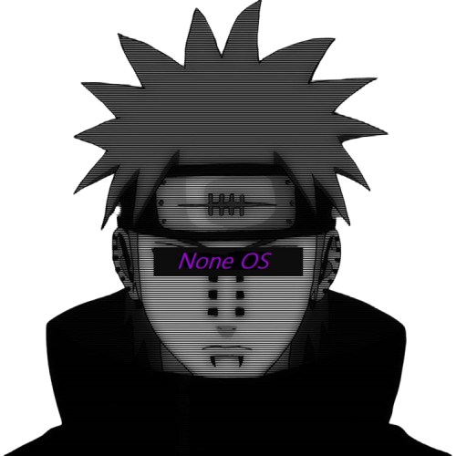

**What it is:** An [AME Wizard](https://ameliorated.io) playbook that tunes a fresh Windows install for competitive gaming — less background work, stronger privacy defaults, performance settings, and optional extras. Windows stays real and reversible. NoneOS Toolbox and the other apps below are downloaded during the install when you choose them.

**Current version:** **R11.37**

**Download:** [NoneOS.apbx](https://github.com/LazyDevss/NoneOS-Releases/releases/download/noneos/NoneOS.apbx)

Same file, versioned name: [NoneOS-R11.37.apbx](https://github.com/LazyDevss/NoneOS-Releases/releases/download/noneos/NoneOS-R11.37.apbx) · release notes: [noneos](https://github.com/LazyDevss/NoneOS-Releases/releases/tag/noneos)

**How to install:** Download the `.apbx` → open AME Wizard → drag the file in → choose options → keep internet on during the run.

---

## NoneOS Toolbox — post-install control panel

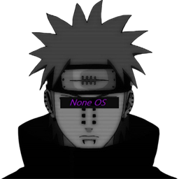

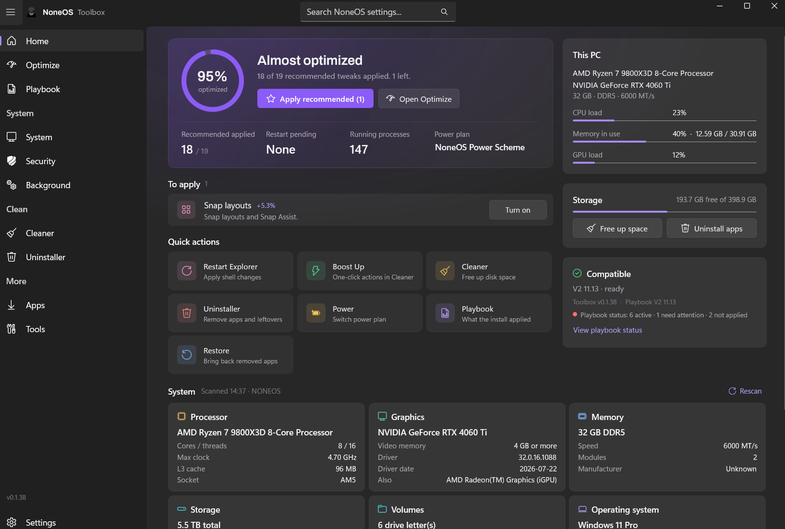

**What it is:** The NoneOS control panel (WinUI 3). After a NoneOS install it lets you review options, apply recommended tweaks, install common software, and manage post-install tools. You can also download it on its own if you already run NoneOS.

**Current version:** **0.1.39**

**Download:** [NoneToolbox-win-x64.zip](https://github.com/LazyDevss/NoneOS-Releases/releases/download/toolbox/NoneToolbox-win-x64.zip)

Release: [toolbox](https://github.com/LazyDevss/NoneOS-Releases/releases/tag/toolbox)

---

## NoneAlt — instant replay buffer

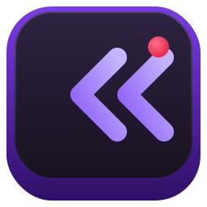

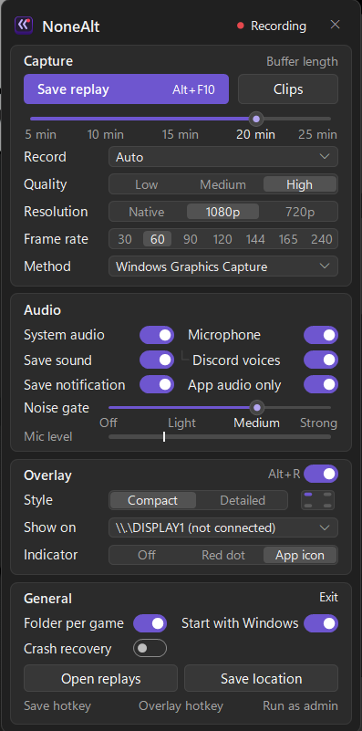

**What it is:** An always-on replay buffer for Windows. It sits in the tray, records quietly with your GPU’s hardware encoder, and one hotkey (`Alt+F10`) saves the last few minutes as an MP4. No account, no network. Optional FPS/latency overlay.

**Current version:** **1.0.3**

**Download:** [NoneAlt-Setup.exe](https://github.com/LazyDevss/NoneOS-Releases/releases/download/nonealt/NoneAlt-Setup.exe)

Release: [nonealt](https://github.com/LazyDevss/NoneOS-Releases/releases/tag/nonealt)

---

## NoneHz — USB controller polling rate

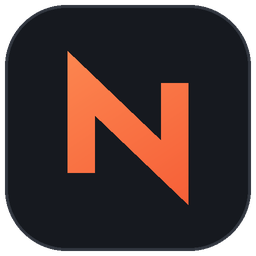

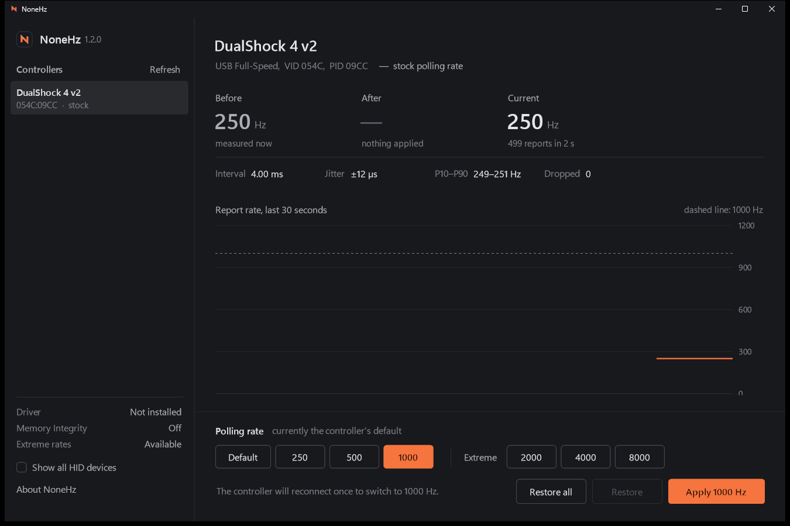

**What it is:** A small tool to raise the USB polling rate of wired game controllers (DualShock 4, DualSense, DualSense Edge, and other wired HID pads). Live Hz meter, Before/After checks, and restore to stock. Front end for [hidusbf](https://github.com/LordOfMice/hidusbf) (SweetLow) with Microsoft-signed driver builds.

**Current version:** **1.2.3**

**Download:** [NoneHz.exe](https://github.com/LazyDevss/NoneOS-Releases/releases/download/nonehz/NoneHz.exe)

Release: [nonehz](https://github.com/LazyDevss/NoneOS-Releases/releases/tag/nonehz)

---

## NoneBoost — quiet game booster

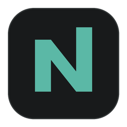

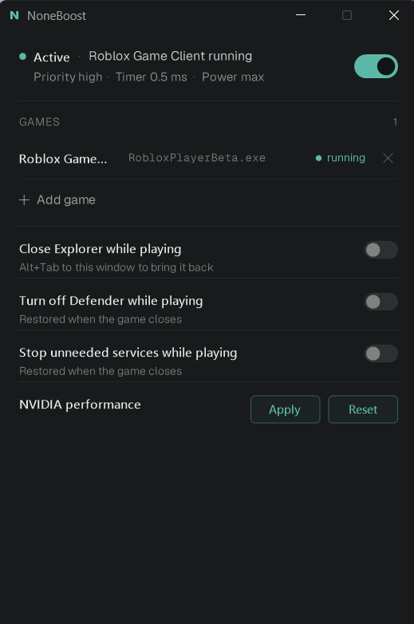

**What it is:** A small tray app that watches for the games you add. While a game runs it can raise process priority, set a 0.5 ms timer resolution, switch to a max power plan, and optionally pause idle services or soft-disable Defender — then put everything back when the game closes. No injection, no drivers, one small exe.

**Current version:** **1.1.4**

**Download:** [NoneBoost.exe](https://github.com/LazyDevss/NoneOS-Releases/releases/download/noneboost/NoneBoost.exe)

Release: [noneboost](https://github.com/LazyDevss/NoneOS-Releases/releases/tag/noneboost)

---

## FIVEMOS — FiveM graphics pack

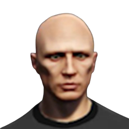

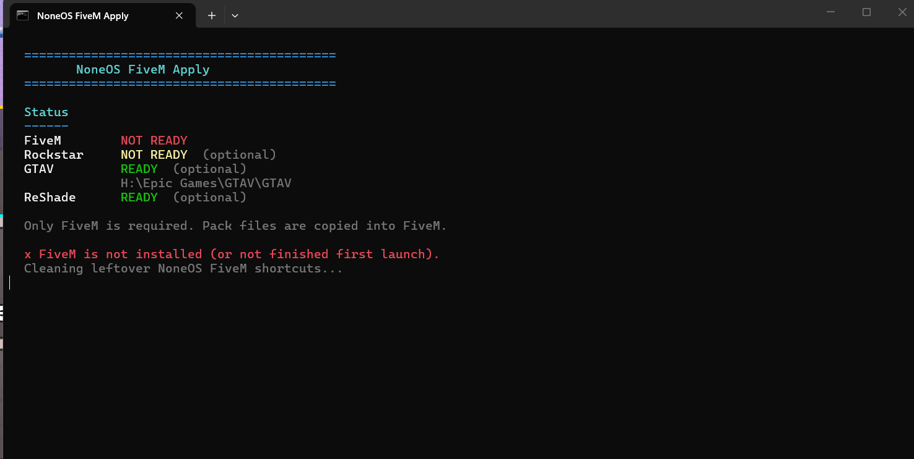

**What it is:** An optional FiveM graphics/settings pack (ReShade, citizen overlays, mods, captured settings/profile). Works with or without a full NoneOS install. Run **NoneOS FiveM Apply** after FiveM is installed.

**Current version:** **1.0.1**

**Download:** [FIVEMOS.zip](https://github.com/LazyDevss/NoneOS-Releases/releases/download/fivem/FIVEMOS.zip)

Release: [fivem](https://github.com/LazyDevss/NoneOS-Releases/releases/tag/fivem)

---

## DirectX June 2010 redistributable (dependency)

Not a NoneOS app. Microsoft’s DirectX June 2010 redist — NoneOS downloads it automatically during install when needed (older games / d3dx). You normally do **not** need to download this yourself.

**Download (for reference):** [directx_Jun2010_redist.exe](https://github.com/LazyDevss/NoneOS-Releases/releases/download/directx/directx_Jun2010_redist.exe)

Release: [directx](https://github.com/LazyDevss/NoneOS-Releases/releases/tag/directx)

---

## Stable links (never change)

| Product | Direct download |
|---|---|
| NoneOS | https://github.com/LazyDevss/NoneOS-Releases/releases/download/noneos/NoneOS.apbx |
| NoneOS Toolbox | https://github.com/LazyDevss/NoneOS-Releases/releases/download/toolbox/NoneToolbox-win-x64.zip |
| NoneAlt | https://github.com/LazyDevss/NoneOS-Releases/releases/download/nonealt/NoneAlt-Setup.exe |
| NoneHz | https://github.com/LazyDevss/NoneOS-Releases/releases/download/nonehz/NoneHz.exe |
| NoneBoost | https://github.com/LazyDevss/NoneOS-Releases/releases/download/noneboost/NoneBoost.exe |
| FIVEMOS | https://github.com/LazyDevss/NoneOS-Releases/releases/download/fivem/FIVEMOS.zip |
| DirectX (dependency) | https://github.com/LazyDevss/NoneOS-Releases/releases/download/directx/directx_Jun2010_redist.exe |

Each release page lists file size and MD5 so you can check your download.
